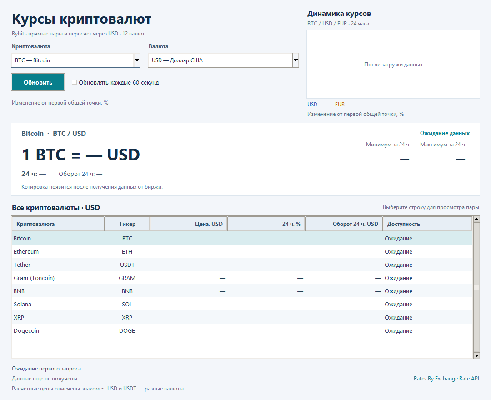

# Итоговый проект — курсы криптовалют и динамика за 24 часа

Приложение на Python и Tkinter показывает **BTC, ETH, USDT, GRAM, BNB, SOL, XRP и DOGE**:
прямые цены **Bybit Spot** и явно обозначенные расчётные курсы.
Поле **«Валюта»** содержит все 11 валют из пользовательского `валюта.py`:
**EUR, USD, JPY, GBP, AUD, CAD, CHF, CNY, RUB, KZT, UZS**, а также **USDT**.
Два `ttk.Combobox` выбирают монету и валюту. Карточка и таблица показывают цену,
**изменение за 24 часа** и **оборот торгов за 24 часа для каждой из восьми монет**.
Рост отмечается зелёным **▲**, снижение — красным **▼**; нулевое изменение нейтральное.
Таблица содержит шесть колонок: криптовалюта, тикер, цена, «24 ч, %»,
«Оборот 24 ч» и доступность. Цена и оборот подписаны выбранной валютой.
Цвет строки соответствует направлению изменения.
Суточные минимум и максимум остаются в карточке выбранной пары.
Увеличенная панель **«Динамика курсов»** у верхнего края справа
сравнивает выбранную криптовалюту к **USD и EUR** за 24 часа.
Кнопка «Обновить» расположена ниже списков. GRAM — актуальный тикер бывшего TON на Bybit.

Проверка 12 ноября 2026 года подтвердила:

| Валюта цены | Прямые пары |
| --- | --- |
| USD | BTCUSD, ETHUSD, USDTUSD |
| EUR | BTCEUR, ETHEUR, USDTEUR, GRAMEUR, SOLEUR, XRPEUR, DOGEEUR |
| USDT | BTCUSDT, ETHUSDT, GRAMUSDT, BNBUSDT, SOLUSDT, XRPUSDT, DOGEUSDT |

**USDT не приравнивается к USD.** Курс USDT/USD берётся с рынка, без подстановки 1.
При наличии прямой пары используется её цена. Для остальных валют выполняется
явный пересчёт: цена монеты в USD умножается на курс USD к выбранной валюте.
Если прямой USD-пары нет, USD-цена рассчитывается как `coin/USDT × USDT/USD`.
Источники и признак расчёта видны в интерфейсе; `≈` отличает оценку от прямой цены.
Без необходимых данных строка остаётся без чисел. USDT/USDT — совпадение валют,
без вымышленной рыночной цены. Суточные минимумы и максимумы показываются только
для прямых пар: экстремумы разных рынков не перемножаются.

Фиатные курсы приходят из того же открытого API, что использовался в `валюта.py`:
**ExchangeRate-API**. Они обновляются раз в сутки; дата курса указана отдельно.
Ответ кэшируется до следующего обновления. Источник: [Rates By Exchange Rate API](https://www.exchangerate-api.com).

## Материалы итогового проекта

- [Техническое задание для чтения на GitHub](docs/final_spec.md).
- [Техническое задание в Word с эскизом](docs/final_spec.docx).
- [Эскиз интерфейса](assets/final_ui_sketch.png).
- [Проверка Bybit, OKX, BingX, Gate и условий для РФ](docs/final_exchange_review.md).
- [Программа «Zadanie_final.py»](<Zadanie_final.py>) — интерфейс, клиент API и встроенная иконка в одном файле.



Эскиз показывает начальное состояние. В работающей программе значения
заполняются только после успешного ответа API; демонстрационные цены не выдаются
за текущие.

## Почему выбран Bybit

После сравнения CoinGecko, CoinPaprika, Coinbase, Kraken, Bybit, OKX, BingX
и Gate для проекта выбран **BybitClient**. Публичный
запрос не требует аккаунта или ключа и возвращает несколько спотовых пар
одновременно. За данные отвечает класс `BybitClient`, за интерфейс —
`CryptoApp`; оба класса находятся в одном файле программы.

`GET https://api.bybit.com/v5/market/tickers?category=spot` возвращает
`retCode`, `result.category` и `result.list`. Проверяется именно категория
`spot`, затем используются `lastPrice`, `lowPrice24h`, `highPrice24h`,
`price24hPcnt` и `turnover24h`.
Данные контрактов и индекс `usdIndexPrice` не используются.

Для прямой пары процент изменения — `price24hPcnt × 100`.
Колонка «Оборот 24 ч» использует `turnover24h` — денежный оборот этой спотовой пары в валюте котировки,
например USD у BTCUSD. Это не поле `volume24h`, измеряемое в количестве монет,
и не оборот криптовалюты по всем биржам. Общая сумма по монетам не выводится.

При расчёте USD через USDT используется составное изменение:
`((1 + r_coin/USDT) × (1 + r_USDT/USD) − 1) × 100%`, где `r` — доли из API.
Оборот исходной пары монета/USDT умножается на **текущий** USDT/USD.
Это оценка в USD: пересчёт каждой сделки по её собственному историческому курсу
не выполняется. При дальнейшем переводе в фиат оборот умножается на суточный FX,
а процент изменения сохраняется при фиксированном множителе.
Расчётные показатели отмечены `≈`; карточка показывает исходную пару и путь
пересчёта. Такой оборот не выдаётся за торги несуществующей пары, например BTC/RUB.
Отсутствующая или некорректная метрика отображается прочерком и не отменяет
корректную цену; нулевой оборот показывается как 0.

`GET /v5/market/kline` с `category=spot` получает 15-минутные свечи выбранных
рынков. Спарклайн строится по реальным данным, без случайных или демонстрационных
точек. Для расчёта через USDT/USD соединяются только свечи с одинаковым временем.
Для EUR используется собственная история прямой пары, если она есть.
Иначе весь USD-ряд умножается на **один фиксированный FX-курс**: его дата
подписана, изменения USD/EUR внутри суток не учитываются.

Синяя линия обозначает USD, оранжевая — EUR. Чтобы сопоставлять динамику разных
валют, обе цены переводятся в процент изменения от первой общей точки:
`(цена сейчас / цена в начале периода − 1) × 100%`. Начало обеих линий — 0%,
шкала процентов общая. Легенда показывает цвет, валюту и итоговое изменение
от первой точки графика. Этот показатель может отличаться от отдельной метрики
«24 ч, %» из ticker из-за времени первой закрытой свечи.
При фиксированном пересчёте EUR тренды совпадают; EUR рисуется пунктиром,
и подпись объясняет совпадение. Линии не сдвигаются искусственно.
Если одна история недоступна, остаётся доступная линия с пояснением ошибки.

Ось **X** показывает фактические часы и минуты **по МСК**; даты по краям
различают начало и конец суточного периода. Правая граница соответствует
времени снимка котировок. Метки обновляются вместе с данными, поэтому старый
снимок не подписывается как «сейчас».

- [Bybit — Ticker](https://bybit-exchange.github.io/docs/v5/market/tickers).
- [Bybit — валюты и статус инструментов](https://bybit-exchange.github.io/docs/v5/market/instrument).
- [Bybit — свечи Kline](https://bybit-exchange.github.io/docs/v5/market/kline).
- [ExchangeRate-API — открытый API, обновление и условия](https://www.exchangerate-api.com/docs/free).
- [Bybit — прямые спотовые пары к USD](https://www.bybit.com/en/press/post/bybit-launches-usd-trading-pairs-simplifying-usd-on-ramp-for-traders-blt8cdc9184fde4695e).

Успешный публичный запрос не подтверждает доступность регистрации, KYC или
торговли для конкретного пользователя. Региональные ограничения рассмотрены
в [сравнении площадок](docs/final_exchange_review.md).

## Запуск

Нужен **Python 3.10 или новее** с Tkinter и интернет для получения данных.
**Для запуска достаточно скачать один файл `Zadanie_final.py`.** Клиент Bybit,
модели данных, интерфейс и иконка объединены в нём. Другие файлы проекта
содержат ТЗ, тесты и исходные материалы; рядом с программой они не требуются.

Один раз установите `requests`, затем запустите скачанный файл:

```powershell
python -m pip install "requests>=2.32.3,<3"
python "Zadanie_final.py"
```

Иконка встроена в код как Base64. При открытии окна она записывается во
временный ICO, назначается окну и удаляется с диска. Папка `assets` не нужна
для запуска; если платформа не поддерживает ICO, остаётся стандартная иконка.
Файл `requirements_final.txt` сохранён для установки зависимостей всего проекта,
но для приведённых команд скачивать его не нужно.

После запуска котировки загружаются автоматически один раз. Кнопка «Обновить»
обновляет котировки и сравнение USD/EUR выбранной монеты; FX берётся из актуального кэша.
Флажок включает обновление каждые 60 секунд; по умолчанию он выключен.
Минимальный интервал между обновлениями текущих котировок — 5 секунд.

Начальная пара — BTC/USD. Выберите монету и валюту во выпадающих списках;
карточка и заголовки таблицы обновятся сразу, без обращения к сети.
График всегда сравнивает USD и EUR: смена поля «Валюта» меняет карточку и таблицу,
а смена криптовалюты — также обе линии графика. Истории загружаются одним фоновым
потоком с кэшированием. До их получения показывается подпись загрузки.
Быстрое переключение не позволяет ответу прежней монеты подменить новый график.
Щелчок по строке таблицы также выбирает монету. Списки и таблица доступны
с клавиатуры: Tab переводит фокус, стрелки меняют выбор. В списках нельзя
ввести произвольный тикер: используются поддерживаемые приложением активы.
При уменьшении окна таблицу можно прокручивать.

Сеть работает в фоновом потоке, поэтому окно не зависает. При ошибке последний
успешный снимок и прежнее время получения сохраняются, а строка состояния
предупреждает об устаревших данных. До первого успеха в таблице стоят тире.
Смена монеты или валюты сохраняет предупреждение и показывает именно выбранную
пару из последнего снимка. Следующий успешный запрос снимает предупреждение.
Время показано в МСК и обозначает получение данных приложением, а не время сделки.
При успешном частичном ответе отсутствующие пары очищаются; прежняя цена
не выдаётся за свежую. Пустой ответ или ответ, не содержащий ни одной целевой пары, считается ошибкой.
Ошибка FX не блокирует прямые котировки; сохранённый просроченный FX явно отмечается.
Ошибка одной истории не блокирует таблицу или доступную вторую линию.

## Проверки

```powershell
python -m unittest -v test_final
```

Тесты не требуют интернета и используют подготовленные JSON-ответы. Проверяются
разделение валют, рыночный USDT/USD, приоритет прямой пары, расчёт через USD,
FX-кэш и его ошибки, частичные ответы,
категория spot, дубликаты пар, поля цены и диапазона, HTTP/JSON/API-ошибки,
тайм-аут, некорректные числа, очередь результатов, ограничение повторных
запросов, согласованность обоих Combobox с карточкой и таблицей, выбор строки,
сохранение предупреждения при ошибке, время и выравнивание свечей, фиксация FX
в графике, общая база нормализации USD/EUR, частичный отказ истории и защита
от ответа для прежней монеты. Данные тестов условные.
Дополнительно проверяются суточные проценты, составное изменение USD через USDT,
оборот в валюте котировки, его оценочный пересчёт, пропуски и нулевой оборот,
а также стрелки и цвет показателей в интерфейсе.

## Git и этапы подготовки итогового проекта

Итоговый комплект подготовлен тремя последовательными коммитами:

1. **Итоговый проект: переименовать приложение и обновить тесты**.
2. **Итоговый проект: обновить техническое задание и инструкции**.
3. **Итоговый проект: подготовить аттестационную работу и комплект**.

Ссылки на эти коммиты находятся в файле `Коммиты.txt` сдаваемого комплекта —
по одной ссылке на строку. Историю итоговых изменений можно посмотреть командой:

```powershell
git log --oneline --grep="Итоговый проект:"
```

Весь код приложения и иконка находятся в `Zadanie_final.py`. Дополнительные
направления развития — избранные монеты, экспорт CSV и локальная история SQLite;
они не входят в текущую версию.
