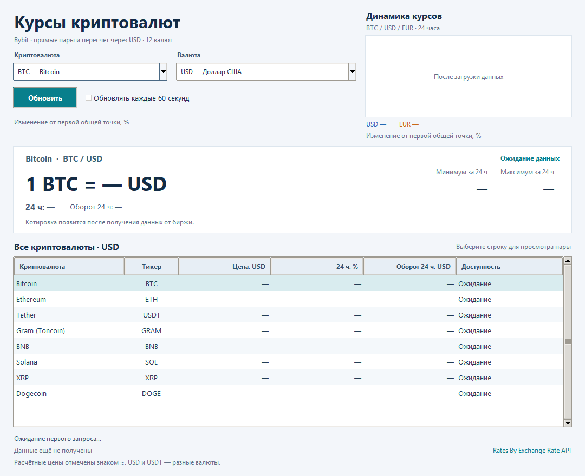

# Техническое задание на приложение курсов криптовалют

Итоговый проект   •   Версия 1.8   •   12 ноября 2026 года

## Назначение и результат

Разработать приложение на Python для просмотра BTC, ETH, USDT, GRAM, BNB, SOL, XRP и DOGE. Поле «Валюта» содержит EUR, USD, JPY, GBP, AUD, CAD, CHF, CNY, RUB, KZT, UZS и USDT. Два Combobox выбирают пару. Карточка и таблица показывают цену, процент изменения и оборот торгов за 24 часа каждой из восьми монет.

В панели «Динамика курсов» сравнить выбранную монету к USD и EUR за 24 часа двумя цветными линиями. Показать процент изменения от общей начальной точки. Bybit предоставляет цены и свечи; при отсутствии прямой пары расчёт через USD и ExchangeRate-API явно подписать. USDT не приравнивать к USD [1, 4, 5].

## Выбор источника

| Сервис | Особенности для проекта |
| --- | --- |
| Bybit | Основной источник криптовалют: текущие цены и свечи. Проверены 3 прямые пары к USD, 7 к EUR и 7 к USDT. |
| ExchangeRate-API | Фиатные курсы из API исходного задания. Обновление раз в сутки, кэш и обязательная ссылка на источник [5]. |
| Kraken | Предыдущий источник проекта с прямыми USD-парами. В версии 1.2 заменён на Bybit. |
| CoinGecko и CoinPaprika | Агрегаторы подходят для рейтинга и капитализации всего рынка; условия доступа и тарифы проверяются перед подключением. |
| Coinbase Exchange | Альтернатива для публичных USD-котировок. Набор инструментов зависит от площадки. |
| OKX, BingX, Gate | Дополнительные варианты проверены отдельно; сравнение и региональные условия приведены на странице 8. |

Bybit выбран по запросу заказчика после проверки публичного API. Выбор относится к разработке приложения просмотра цен. Успешный сетевой запрос не подтверждает доступность регистрации или торговли для конкретного пользователя.

GRAM — актуальный тикер монеты Gram, ранее Toncoin (TON), на Bybit. Сеть сохраняет название TON [3].

## Функциональные требования

- F1. Открыть окно «Динамика курсов» со встроенной иконкой и загрузить данные. Начальный выбор карточки — BTC и USD. До ответа показывать тире. На платформе без поддержки ICO использовать стандартную иконку.

- F2. Два readonly Combobox выбирают монету и одну из 12 валют. Второе поле подписать «Валюта». Карточка и заголовки таблицы явно указывают валюту; расчётные цены обозначаются знаком ≈ и источником.

- F3. Кнопка «Обновить» ниже списков обновляет цены и выбранный график, сохраняя выбор. Для текущих цен не запускать параллельный запрос; минимальный интервал — 5 секунд.

- F4. Автообновление каждые 60 секунд по умолчанию выключено. Выбор сразу меняет карточку и таблицу из снимка; история при необходимости загружается отдельно. Строка таблицы синхронизирует список монет.

- F5. Показывать источники, время получения в МСК и отдельную дату FX. Добавить доступную ссылку «Rates By Exchange Rate API». Время получения не обозначает время сделки.

- F6. Прямая пара имеет приоритет. При отсутствии данных для расчёта показать прочерки. Для USDT/USDT не выводить рыночную цену. Суточные минимум и максимум доступны только прямым парам.

- F7. При общей ошибке сохранить последний снимок и время, явно пометить данные устаревшими. Смена выбора не снимает предупреждение. До первого успеха оставить тире; успешный ответ снимает ошибку.

- F8. Окно остаётся отзывчивым и закрывается во время загрузки. Поддержать Tab, стрелки, прокрутку и длинные значения, в том числе BTC/UZS.

- F9. Панель «Динамика курсов» расположена у верхнего края справа и показывает выбранный тикер / USD / EUR. Синяя USD и оранжевая EUR используют общую процентную шкалу. Ось X показывает часы МСК с датами границ. Поле «Валюта» меняет только карточку и таблицу.

- F10. Расчёт и дату FX подписать; при совпадении линий EUR показать пунктиром. Отказ одной истории не скрывает вторую. При смене монеты убрать чужие линии; поздний ответ не подменяет новый выбор.

- F11. В карточке и таблице показать изменение за 24 часа: зелёный ▲ для роста, красный ▼ для снижения, нейтральный ноль. Цвет строки соответствует направлению; знак и число сохраняются.

- F12. В колонке «Оборот 24 ч» и карточке показать денежный оборот пары в выбранной валюте. Расчёт отметить ≈ и исходным рынком. Пропуск — прочерк, нулевой оборот — 0. Минимум и максимум оставить в карточке; общую сумму не выводить.

## Требования к реализации

Python 3.10 или новее, Tkinter и ttk, requests для HTTPS и JSON; основная среда — Windows. Для запуска нужен только «Zadanie_final.py» и установленный requests. Установка: python -m pip install "requests>=2.32.3,<3". Сеть работает в отдельном потоке, виджеты обновляет главный поток через очередь и after().

Тайм-аут соединения — 5 секунд, чтения — 10 секунд; это отдельные ограничения requests, а не общий предел длительности запроса. Проверять HTTP-статус, retCode, категорию spot, список и числовые поля JSON.

Цены хранить как Decimal и принимать только конечные положительные значения; минимум не должен превышать максимум. Ниже 10 сохранять шесть значащих цифр, чтобы видеть малые цены и отклонения USDT/USD от 1.

## Эскиз интерфейса

Окно с изменяемыми размерами: два списка выбора, график USD/EUR у верхнего края справа, кнопка обновления ниже списков, карточка и таблица восьми монет с ценой, суточным изменением и оборотом. Эскиз показывает начальное состояние; до ответа API используются тире.

Рисунок 1. Выбор валют, сравнение USD/EUR и показатели каждой монеты за 24 часа. Данные заполняются после ответа API.

## Состояния окна

| Состояние | Отображение |
| --- | --- |
| Загрузка | Кнопка временно недоступна; монету и валюту можно выбирать. |
| Успех | Карточка и таблица обновлены; отсутствующие пары показаны без чисел. |
| Ошибка при запуске | Понятная причина ошибки; вместо цен остаются тире. |
| Ошибка после успеха | Сохранены снимок и время; предупреждение остаётся при смене пары. |

## Границы приложения

Только просмотр цен и динамики. Торговля, кошельки и расчёт доходности не входят в задание. Расчётные значения предназначены для сравнения и не являются ценой сделки на несуществующем рынке.

## Обмен данными и торговые пары

Запрос: GET https://api.bybit.com/v5/market/tickers с category=spot. Успех: retCode=0, result.category="spot", result.list — список. Поля: symbol, lastPrice, lowPrice24h, highPrice24h, price24hPcnt, turnover24h [1].

| Актив | USD | EUR | USDT |
| --- | --- | --- | --- |
| Bitcoin / BTC | BTCUSD | BTCEUR | BTCUSDT |
| Ethereum / ETH | ETHUSD | ETHEUR | ETHUSDT |
| Tether / USDT | USDTUSD | USDTEUR | Совпадает |
| Gram / GRAM | Расчёт | GRAMEUR | GRAMUSDT |
| BNB | Расчёт | Расчёт | BNBUSDT |
| Solana / SOL | Расчёт | SOLEUR | SOLUSDT |
| XRP | Расчёт | XRPEUR | XRPUSDT |
| Dogecoin / DOGE | Расчёт | DOGEEUR | DOGEUSDT |

Проверено 12 ноября 2026 года. Все 17 найденных прямых пар подтверждены instruments-info: spot, Trading, правильные baseCoin и quoteCoin [2]. Для остальных фиатных валют применить расчёт через USD. Новая прямая пара имеет приоритет, если появится в ответе.

Сопоставлять полные коды пар из разрешённого набора. USDC, обратные пары и производные инструменты не включать. USDTUSD — реальная рыночная цена; USDTUSDT не запрашивать и не подменять константой 1. Не перемножать суточные экстремумы разных пар.

## Структура и проверка ответа

«Zadanie_final.py» содержит модели, клиент BybitClient, CryptoApp и иконку Base64. Quote хранит цену, валюту, суточное изменение и оборот, доступность, признак расчёта, исходный рынок, путь пересчёта и дату FX. Snapshot содержит 96 строк для 8 монет × 12 валют. Отдельная модель истории хранит точки со временем и выбранную пару. test_final.py проверяет единый файл.

Иконку записывать во временный ICO только при открытии окна, назначать окну и удалять временный файл. Для запуска не нужны отдельный модуль API и папка assets. Импорт программы не должен открывать GUI или обращаться к сети; проверять запуск копии одного файла из отдельной папки.

Неполный корректный список допустим: пары без прямой котировки и достаточных данных для пересчёта имеют статус missing. Пустой ответ, отсутствие всех целевых пар, ошибочный retCode, неверная категория или структура, дубликаты пар и некорректные обязательные цены вызывают общую ошибку. Необязательные процент и оборот проверяются отдельно. Успешный снимок заменяет данные целиком.

## Изменение цены и оборот за сутки

### Прямые торговые пары

Поле price24hPcnt содержит относительное изменение цены: для процентов умножить его на 100. В карточке и таблице рост обозначить зелёным ▲, снижение — красным ▼; ноль показать нейтрально. Цвет строки соответствует направлению, а знак и число сохраняют смысл без распознавания цвета [1].

Таблица содержит шесть колонок: криптовалюта, тикер, цена, «24 ч, %», «Оборот 24 ч» и доступность. Цену и оборот подписать выбранной валютой. Суточные минимум и максимум оставить только в карточке, чтобы таблица помещалась в окне.

Колонка «Оборот 24 ч» использует turnover24h — денежный оборот выбранной спотовой пары в валюте котировки. Например, оборот BTCUSD измеряется в USD. Поле volume24h обозначает количество монет и не используется. Показатель относится к отдельному рынку Bybit, а не ко всем биржам или всем парам монеты. Общая сумма не требуется.

### Расчётные показатели

Если USD-цена получена через монета/USDT и USDT/USD, использовать составное изменение: ((1 + r₁) × (1 + r₂) − 1) × 100%, где r₁ и r₂ — доли price24hPcnt соответствующих рынков из одного ответа. Если один показатель отсутствует, расчётный процент не выводить. При переводе через фиксированный суточный FX процент не меняется.

Оборот монета/USDT умножить на текущую цену USDT/USD; для другой фиатной валюты дополнительно умножить на FX(USD→валюта). Если исходная пара сразу к USD, использовать её оборот. Это оценка денежного оборота исходного рынка в другой валюте, а не сумма сделок, пересчитанных по историческому курсу каждой сделки.

Расчётные значения отметить знаком ≈. В карточке указать исходную торговую пару и маршрут пересчёта; дату и устаревание FX сохранить. Не выдавать рассчитанный оборот BTC/RUB за торги такой пары на Bybit. Прямая пара имеет приоритет над расчётом, включая её собственные процент и оборот.

### Пропуски и проверка

Отсутствующую или некорректную метрику показывать прочерком, сохраняя корректную цену. Нулевой оборот допустим и отображается как 0. NaN, бесконечности, отрицательный оборот и изменение не выше −100% считать пропуском. Не заменять пропуски нулём или демонстрационным числом.

Проверить прямые значения, составное изменение через USDT, оценочный пересчёт оборота, ноль и пропуски, приоритет прямого рынка, стрелки и цвет. Суточный процент ticker может отличаться от изменения в легенде графика: график нормализован от первой доступной общей закрытой свечи, а не подменяет поле price24hPcnt.

## Расчёт валют и спарклайн

### Текущие расчётные цены

Если прямой пары нет, сначала найти цену в USD. Использовать прямую монета/USD; иначе умножить монета/USDT на фактическую USDT/USD из того же снимка. Для фиатной валюты C: цена(C) = цена(USD) × FX(USD→C). Не подставлять USDT/USD = 1. Отсутствующий множитель означает отсутствие оценки.

FX: GET https://open.er-api.com/v6/latest/USD. Проверять result="success", base_code="USD", rates, положительные конечные курсы и даты time_last_update_unix/time_next_update_unix. Кэшировать до следующего обновления; после ошибки ограничивать повторные попытки. Старый FX допустим только с явной пометкой об устаревании [5].

Минимумы и максимумы разных рынков не перемножать. У расчётных пар поля суточных экстремумов остаются пустыми. Значение ≈ и маршрут расчёта отличают такую цену от прямой биржевой котировки.

### История за 24 часа

Bybit GET /v5/market/kline: category=spot, выбранный symbol, interval=15 и согласованное окно времени. Ответ идёт в обратном порядке; преобразовать его в возрастающий ряд. Проверять символ, категорию, числа, дубликаты и время. Использовать закрытые close с временем окончания свечи; текущую цену добавить отдельной точкой наблюдения [4].

Ось X показывает часы и минуты в МСК, а даты на краях различают начало и конец 24 часов. Правая граница — время снимка котировок. Метки обновляются вместе с данными; старый снимок не обозначать словом «сейчас».

Загрузить USD и EUR для одной монеты и одного времени снимка. Для расчётной USD-истории перемножать close монета/USDT и USDT/USD только в совпадающие моменты. Прямая EUR-пара имеет приоритет. Расчётный EUR использует один FX-курс для всего ряда: внутрисуточные изменения USD/EUR не учитываются, дата FX подписывается.

Привести обе линии к первой общей точке t₀: изменение(t) = (цена(t) / цена(t₀) − 1) × 100%. Обе начинают с 0%; использовать общую шкалу процентов, не две оси цен. Если EUR получен постоянным множителем USD, тренды совпадают: показать EUR пунктиром и объяснить совпадение. Нельзя искусственно раздвигать линии.

Неполную историю не выдавать за непрерывные 24 часа. Если доступна только одна валюта, показать её линию и причину отсутствия второй. Без обеих историй показывать текст. В легенде указать валюты, цвета и изменение к последней точке.

### Загрузка и согласованность

Один фоновый поток последовательно загружает USD/EUR выбранной монеты, используя кэш. Быстрые переключения объединяются в последний выбор. Результат должен соответствовать монете и версии снимка. Смена валюты карточки не перезапускает график. Canvas обновляется главным потоком и перерисовывается при изменении размера.

## Критерии приёмки

- Поле «Валюта» содержит 11 кодов из исходного файла и USDT. Карточка и таблица соответствуют выбранной паре; график сравнивает эту монету к USD/EUR. Кнопка находится ниже списков.

- Прямые пары имеют приоритет. Пересчёт использует реальный USDT/USD и FX, явно помечается; отсутствующие множители не заменяются единицей. Экстремумы расчётных пар не выдумываются.

- Проверены частичный и пустой ответы, неверная категория, дубликаты, ошибочные числа и диапазон, HTTP 429/500, тайм-аут, сеть, JSON и retCode.

- После ошибки снимок и время сохраняются; смена выбора не скрывает устаревание и не оставляет цену другой пары. Следующий успех снимает предупреждение.

- Свечи согласованы по времени, линии нормализованы от общей точки. Ось X показывает время МСК и даты границ снимка. Расчёт EUR и совпадение трендов подписаны. Частичный отказ сохраняет вторую линию; поздний ответ не рисует чужую монету.

- Окно отвечает и закрывается во время запроса. Один файл запускается отдельно от проекта; тесты проходят, Git содержит минимум три содержательных коммита.

## Этапы работы и Git

Подготовку итогового комплекта разделить на три последовательных коммита:

| Этап | Содержимое |
| --- | --- |
| 1 Программа и тесты | Переименование приложения в Zadanie_final.py, обновление импортов тестов и файла зависимостей. |
| 2 Техническое задание | Обновление ТЗ, инструкций и ссылок на итоговые имена файлов. |
| 3 Аттестационная работа | Документ с полным листингом, материалы для защиты и итоговый комплект. |

Результат сдачи — исходник Zadanie_final.py, техническое задание с эскизом, аттестационная работа и материалы для защиты. Ссылки на три итоговых коммита Evgeny-68/PPBY включаются в файл «Коммиты.txt» сдаваемого комплекта, по одной ссылке на строку.

## Дальнейшее развитие

Возможны расширение списка активов, избранное, подробный график, экспорт CSV и SQLite. При добавлении истории валют использовать согласованные моменты наблюдения. В графиках и экспорте сохранять источник, пару, валюту, метод расчёта и дату FX.

## Основные источники

[[1] Bybit — Tickers и поля спотового ответа](https://bybit-exchange.github.io/docs/v5/market/tickers)

[[2] Bybit — параметры и валюты инструментов](https://bybit-exchange.github.io/docs/v5/market/instrument)

[[3] Bybit — переименование TON в GRAM](https://announcements.bybit.com/en/article/bybit-to-support-toncoin-ton-rebrand-and-ticker-change-to-gram-gram--blt617f4bf48950ab77/?category=delistings)

[[4] Bybit — Kline и поля свечей](https://bybit-exchange.github.io/docs/v5/market/kline)

[[5] ExchangeRate-API — открытые курсы и условия](https://www.exchangerate-api.com/docs/free)

## Дополнительные площадки и условия для РФ

Сравнение выполнено 12 ноября 2026 года для приложения просмотра котировок. Доступность публичного запроса и клиентских услуг проверяются отдельно. Ответ API не подтверждает доступ со всех российских IP, регистрацию, прохождение KYC или торговлю.

| Площадка | Проверка и ограничение |
| --- | --- |
| Bybit | Выбранный источник. Подтверждены 17 прямых пар и исторические свечи. РФ целиком отсутствует в общем списке исключённых юрисдикций; есть территориальные и санкционные ограничения. |
| OKX | Публичные котировки и GRAM-USDT проверены. Для России отдельно указаны ограничения фиатных платёжных услуг. |
| BingX | Публичные BTC/ETH/BNB к USDT проверены. TON/GRAM в общем ответе не подтверждён. РФ целиком отсутствует в опубликованном списке запрещённых юрисдикций. |
| Gate | Публичный API ответил, повторный запрос завершился тайм-аутом. Russia включена в Restricted Locations, п. 2.5 соглашения. |
| Kraken | Предыдущий источник. Россия включена в Prohibited Regions для клиентских услуг. В текущем приложении больше не используется. |

Подробности проверки и дополнительные ссылки находятся в docs/final_exchange_review.md. Это сравнение источников данных для разработки, а не рекомендация открыть счёт или купить активы.

[Bybit — региональные ограничения](https://www.bybit.com/en/help-center/article/Service-Restricted-Countries)

[OKX — региональные и фиатные ограничения](https://www.okx.com/help/risk-compliance-disclosure)

[BingX — опубликованные ограничения](https://bingx.com/en/support/articles/360034028153)

[Gate — соглашение и Restricted Locations](https://www.gate.com/legal/user-agreement)

[Kraken — Prohibited Regions](https://support.kraken.com/articles/where-is-kraken-licensed-or-regulated)

[TON — актуальное название Gram](https://ton.org/)

[Tether — рыночная цена и привязка к доллару](https://tether.io/news/understanding-tethers-peg-and-reserves/)
