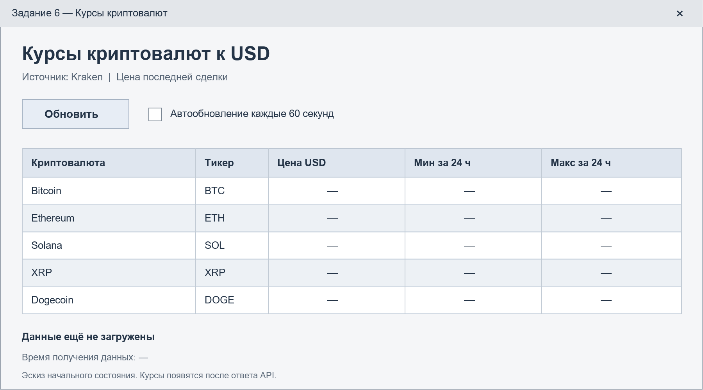

# Техническое задание на приложение курсов криптовалют

Задание 6   •   Версия 1.0   •   12 ноября 2026 года

## Назначение и результат

Разработать настольное приложение на Python, которое показывает текущие цены Bitcoin, Ethereum, Solana, XRP и Dogecoin в долларах США. Пользователь видит все пять криптовалют в одном окне и обновляет данные вручную или автоматически.

Основной источник — публичный API биржи Kraken. Программа показывает цену последней сделки на этой бирже. USD означает доллар США; пары к USDT не используются. Регистрация на бирже и ключ API для выбранного публичного запроса не требуются [1, 2].

## Сравнение источников

| Сервис | Доступ и данные | Польза и ограничение |
| --- | --- | --- |
| CoinGecko Demo | Агрегатор; бесплатный аккаунт и API key; цены в USD. | Широкий охват рынка. Demo: 10 000 запросов в месяц [4]. |
| CoinPaprika Free | Агрегатор; публичные цены без ключа. | 20 000 запросов в месяц; обновление до 10 минут [5]. |
| Coinbase Exchange | Биржа; публичные USD-пары без ключа. | Простое поле price; свечи до 300 точек за запрос. Для выбранного REST ticker каждая пара запрашивается отдельно [6]. |
| Kraken | Биржа; публичные USD-пары без ключа. | Пять пар одним запросом; доступна история OHLC до 720 последних точек [1, 3]. |

Kraken выбран для учебного проекта за пакетный запрос, отсутствие настройки ключей и возможность добавить графики. Coinbase остаётся подходящим вариантом для замены источника; агрегаторы полезнее при добавлении рейтинга и капитализации всего рынка. Условия API проверены 12 ноября 2026 года.

## Функциональные требования

- F1. При запуске открыть русскоязычное окно и начать загрузку котировок. До первого успешного ответа выводить тире вместо значений.

- F2. Показать таблицу с названием монеты, тикером, ценой в USD, минимумом и максимумом за последние 24 часа. Состав: BTC, ETH, SOL, XRP, DOGE.

- F3. Кнопка «Обновить» запускает один общий запрос. Повторный запрос запрещён, пока предыдущий выполняется; минимальный интервал между запросами — 5 секунд.

- F4. Флажок включает обновление каждые 60 секунд. По умолчанию автоматическое обновление выключено; снятие флажка отменяет следующий автоматический запрос.

- F5. Показать источник Kraken и время последнего успешного получения данных с обозначением часового пояса. Это время ответа приложению, а не время последней сделки.

- F6. При ошибке оставить последний успешный набор цен, сохранить прежнее время получения и явно сообщить, что обновление не выполнено и данные могут быть устаревшими. Если данных ещё нет, оставить тире.

- F7. Позволить повторить запрос после ошибки. Закрытие окна во время загрузки должно завершать приложение без зависания.

## Требования к реализации

Использовать Python 3.10 или новее, Tkinter и ttk для интерфейса, requests для HTTPS и JSON. Основная среда проверки — Windows. Внешняя зависимость фиксируется в requirements_task6.txt; Tkinter входит в обычную установку Python для Windows.

Сетевой запрос выполняется в отдельном потоке. Изменение виджетов происходит только в главном потоке через очередь результатов и after(). Во время ожидания ответа окно должно перемещаться, перерисовываться и закрываться.

Тайм-аут соединения — 5 секунд, ожидания чтения — 10 секунд. Это отдельные ограничения requests, а не гарантия общей длительности запроса. Частота приложения существенно ниже рекомендованного Kraken уровня не более одного публичного запроса в секунду [2].

Проверять HTTP-статус, структуру JSON, массив error и числовые значения. Не сохранять неполный набор как успешное обновление. Цены должны быть конечными и положительными; малые значения не округлять до нуля.

## Эскиз интерфейса

Окно приложения размером 920 × 560 пикселей с возможностью изменения размеров. Главное содержимое — таблица пяти криптовалют. Эскиз показывает расположение элементов до загрузки данных.

Рисунок 1. Начальное состояние приложения. Числа появятся только после успешного ответа API.

## Состояния окна

| Состояние | Что видит пользователь |
| --- | --- |
| Загрузка | Сообщение «Загрузка данных…»; кнопка временно недоступна. Окно остаётся отзывчивым. |
| Успех | В таблице одновременно обновлены пять строк. Показаны источник и время получения данных. |
| Ошибка при запуске | Понятное сообщение о сети, HTTP, JSON или ответе API. В таблице остаются тире. |
| Ошибка после успеха | Последние успешные цены сохранены; видна пометка об устаревших данных и причина неудачного обновления. |

## Границы первой версии

Первая версия предназначена для просмотра котировок. Покупка и продажа, кошельки, регистрация пользователей, хранение персональных данных и расчёт доходности в её состав не входят. Работа приложения не требует доступа к биржевому счёту.

## Обмен данными и структура программы

Запрос: GET https://api.kraken.com/0/public/Ticker. Параметр pair: XBTUSD,ETHUSD,SOLUSD,XRPUSD,DOGEUSD. Формат ответа — JSON; успешный ответ содержит пустой массив error и словарь result [1].

| Тикер приложения | Ключ result в Kraken |
| --- | --- |
| BTC | XXBTZUSD |
| ETH | XETHZUSD |
| SOL | SOLUSD |
| XRP | XXRPZUSD |
| DOGE | XDGUSD |

Для каждой пары брать цену из c[0], минимум за последние 24 часа из l[1] и максимум из h[1]. Индекс 0 у l и h относится к текущим суткам; для требуемого периода нужен индекс 1. Поле o не использовать для вычисления изменения за 24 часа: это цена открытия текущих суток UTC [1].

crypto_api_task6.py отвечает за запрос, проверку ответа и приведение данных к Quote и Snapshot. Файл «Задание 6.py» отвечает за интерфейс и обновления. test_task6.py содержит проверки на подготовленных ответах. При смене сервиса заменяется клиент API, а таблица получает ту же нормализованную структуру.

## Критерии приёмки

- Пять котировок USD отображаются в одном окне после одного запроса; значения соответствуют полям полученного ответа API.

- Вручную и автоматически можно обновить данные; одновременные запросы и слишком частые нажатия не создают новых сетевых обращений.

- Проверены HTTP 429/500, тайм-аут, недоступность сети, ошибочный JSON, непустой error, пропущенная пара и некорректная цена.

- После неудачного обновления прежние значения и время не заменяются новыми; пользователь видит предупреждение. После последующего успеха предупреждение снимается.

- Окно остаётся отзывчивым во время загрузки и закрывается без ожидания сети. Тесты проходят; в Git есть не менее трёх последовательных содержательных коммитов.

## Этапы работы и Git

| Этап | Содержимое коммита |
| --- | --- |
| 1 Проектирование | Техническое задание, сравнение источников и эскиз интерфейса. |
| 2 Данные | Клиент Kraken API, модели котировок, обработка ошибок и файл зависимостей. |
| 3 Приложение | Графический интерфейс, обновления, тесты и инструкция запуска. |

Результат сдачи: исходные файлы, техническое задание с эскизом, инструкция запуска и ссылки на три коммита в репозитории Evgeny-68/PPBY. Изменения предыдущих заданий сохраняются.

## Развитие в итоговом проекте

Следующий этап может включать выбор монет, избранное, график цены, экспорт CSV и сохранение истории в SQLite. Для первого графика использовать публичный OHLC Kraken. Он возвращает не более 720 последних точек, включая текущую незавершённую свечу; произвольную старую историю через since получить нельзя [3]. Для более длительного хранения нужно заранее накапливать данные или выбрать другой источник.

Добавление другого API должно быть отдельной реализацией клиента с теми же полями Quote и Snapshot. Интерфейс обязан показывать фактически выбранный источник; автоматически смешивать цены разных бирж в одной серии нельзя. Торговые функции в план итоговой версии не включены.

## Официальные источники

[[1] Kraken — поля Ticker и несколько торговых пар](https://docs.kraken.com/api-reference/market-data/get-ticker-information)

[[2] Kraken — публичный доступ без ключа](https://support.kraken.com/articles/360000919986-public-endpoint-examples-you-can-try-them-directly-in-a-web-browser-)

[[2] Kraken — ограничения частоты запросов](https://support.kraken.com/articles/206548367-what-are-the-api-rate-limits-)

[[3] Kraken — история OHLC и ограничение 720 точек](https://docs.kraken.com/api-reference/market-data/get-ohlc-data)

[[4] CoinGecko — API и условия Demo](https://www.coingecko.com/en/api)

[[4] CoinGecko — получение Demo API key](https://support.coingecko.com/articles/9471335603-user-guide-how-to-sign-up-for-coingecko-demo-api-and-generate-an-api-key)

[[5] CoinPaprika — бесплатный API и тарифные ограничения](https://docs.coinpaprika.com/api-plans)

[[6] Coinbase Exchange — публичные рыночные данные](https://docs.cdp.coinbase.com/exchange/introduction/welcome)

[[6] Coinbase Exchange — ticker](https://docs.cdp.coinbase.com/api-reference/exchange-api/rest-api/products/get-product-ticker)

[[6] Coinbase Exchange — свечи](https://docs.cdp.coinbase.com/api-reference/exchange-api/rest-api/products/get-product-candles)

Документация и доступность тестовых запросов проверены 12 ноября 2026 года. При дальнейшем развитии тарифы и ограничения API необходимо сверить повторно.
